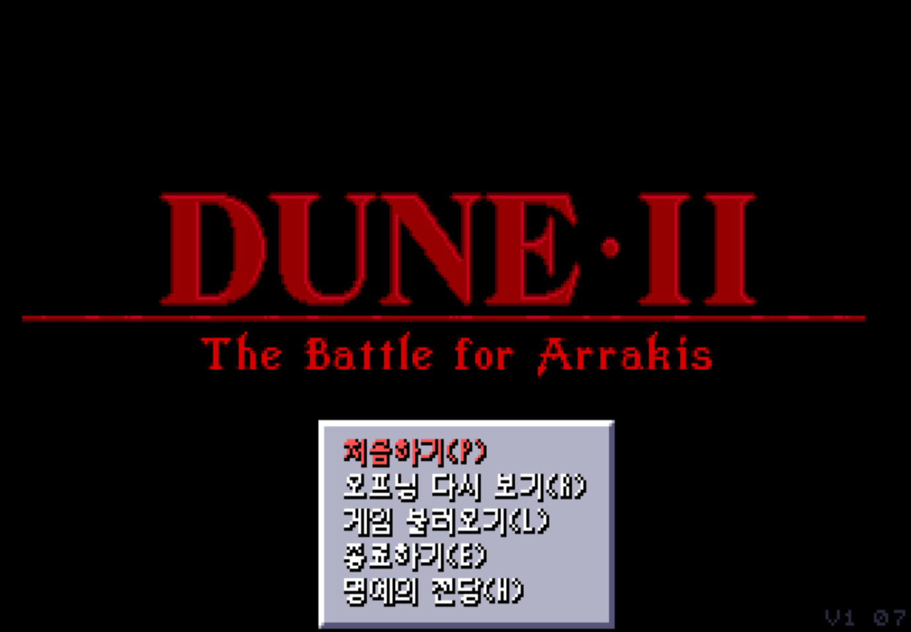

# Dune2 Battle for Arrakis Korean v1.01

*Dune II: The Battle for Arrakis* 한국어 패치와 CD 빌드 도구입니다. HitSquad 1.07 Fix를 포함합니다.



## 주요 기능

- 가문 소개, 임무 설명·조언, 멘타트, 메뉴, 유닛·건물 정보와 게임 메시지 번역
- 일반 화면의 달무리 한글과 영상 자막의 유니폰트 적용
- 게임 명령·메뉴의 영문 단축키와 화면별 테두리·간격 적용
- 영상 자막·음성 동시 출력과 하코넨·오르도스 중간 영상의 마지막 자막 표시
- 보안 질문 생략과 임무 설명 화면의 페이드 전환

## 빌드

필요한 도구는 Python 3.14와 Pillow입니다. CD 패치에는 포함된 `tools/xdelta3.exe`를 사용합니다. ASM 조립에는 포함된 `import/asm/JWasm.exe`를 사용합니다.

1. `img/` 폴더를 만들고 원본 CD 이미지 파일을 넣습니다. 원본은 [SHA-256](doc/PATCHING.md#패치-입력)으로 식별하므로 파일명과 확장자는 자유입니다.
2. 프로젝트 루트에서 다음 명령을 실행합니다.

```powershell
python tools/build_game.py
```

게임 파일은 `build/final-build/source/VIRGIN/DUNE2/`에 생성됩니다. 게임은 사용자가 준비한 DOS 실행 환경에서 실행합니다.

`build/`에는 실행용 게임과 빌드·검사 보고서를 둡니다.

| 경로 | 내용 |
|---|---|
| `build/final-build/` | 최종 게임 파일과 빌드 보고서 |
| `build/final-build/source/VIRGIN/DUNE2/` | 실행용 게임 폴더 |
| `build/final-build-check.json` | `python tools/check_final_build.py` 실행 시 생성되는 검사 보고서 |
| `build/analysis-deps/` | 검사용 Capstone·Unicorn의 로컬 설치 위치 |

CD 배포물은 `output/`에 생성됩니다.

| 파일 | 용도 |
|---|---|
| `Dune2-Battle-for-Arrakis-Korean-v1.01.bin` | 한글 CD 이미지 |
| `Dune2-Battle-for-Arrakis-Korean-v1.01.cue` | BIN 마운트 정보 |
| `Dune2-Battle-for-Arrakis-Korean-v1.01.bin.xdelta` | 원본 CD에 적용할 패치 |
| `Dune2-Battle-for-Arrakis-Korean-v1.01.json` | 원본·결과 해시와 CD 구성 정보 |

## Xdelta 적용

원본 CD 이미지를 `img/`에, 배포받은 `.bin.xdelta`와 `.json`을 `output/`에 넣고 실행합니다.

```powershell
python tools/clonecd_xdelta.py apply
```

생성된 BIN과 CUE를 함께 사용합니다. 경로 지정 옵션은 [패치 적용 안내](doc/PATCHING.md)에 있습니다.

## 번역·CG 수정

번역은 `import/strings/`의 CSV에서, CG는 `import/GFX/images/`의 PNG에서 수정합니다. 수정 후 빌드 명령을 실행하면 게임과 CD 배포물에 반영됩니다. 원본 CG와 EXE 검토표는 `export/`에 자동 생성됩니다.

문자열의 `%s`·`%d` 같은 서식을 유지하고, PNG의 크기·팔레트 색 번호·투명색을 유지해야 합니다. 자세한 내용은 [빌드 안내](doc/BUILD.md)와 [CG 편집 안내](doc/GRAPHICS.md)를 참고하세요.

## 치트

게임 진행 중 Enter로 치트창을 열고 명령을 입력합니다. 빈 입력에서 Enter를 누르면 닫습니다.

| 명령 | 동작 |
|---|---|
| `CREDITS` | 크레딧 10,000 증가 |
| `WIN` | 임무 승리 |
| `LOSE` | 임무 패배 |
| `FASTBUILD` | 내 가문의 건물·유닛 생산 속도 5배 켜기·끄기 |
| `REVEAL` | 현재 플레이어의 지도·미니맵 공개 |

## 자료와 문서

| 폴더 | 내용 |
|---|---|
| `doc/` | 사용 안내와 게임 역분석 기록 |
| `font/` | 달무리·유니폰트 글리프와 라이선스 |
| `import/` | 번역·편집 PNG·ASM·패치 입력 |
| `tools/` | 추출·인코딩·빌드·검사 도구 |

전체 안내는 [문서 목차](doc/README.md), 버전·산출물 해시는 [최종 빌드 상태](doc/STATUS.md), 도구별 명령은 [도구 안내](tools/README.md)에 있습니다.

## 라이선스

프로젝트 도구 소스에는 [MIT 라이선스](LICENSE-MIT-PROJECT.txt)를 적용합니다. 게임 리소스와 글꼴·제3자 도구의 저작권은 각 권리자에게 있습니다. 글꼴은 [font/README.md](font/README.md), JWasm은 [ASM 입력 안내](import/asm/README.md), HitSquad Fix는 패키지의 배포 문서를 참고하세요.
